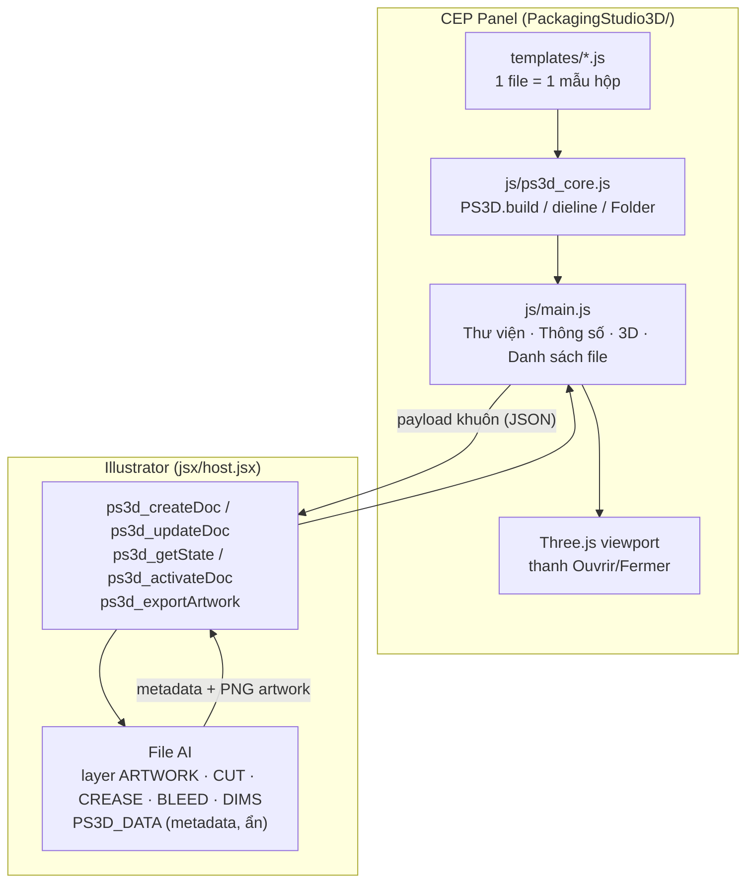

# Packaging Studio 3D — Kiến trúc & Mindmap (v2)

## 1. Sơ đồ

## 2. Module

| File | Vai trò |
|---|---|
| `PackagingStudio3D/js/ps3d_core.js` | Engine dùng chung. Mẫu → model (panels, hinges). Sinh CUT (nối liền) / CREASE cho AI, thumbnail SVG, `PS3D.Folder` gập 3D (chiều gập tự tính: `angle` dương = gập vào trong). |
| `PackagingStudio3D/templates/*.js` | Mẫu hộp: `reverse_tuck`, `straight_tuck`, `tray`. Mẫu mới thả vào thư mục sẽ được nạp tự động (Node trong CEP). |
| `PackagingStudio3D/js/main.js` | UI panel, theo dõi file đang active (sự kiện `documentAfterActivate`/`documentAfterSave` + polling 2s), cache artwork theo từng file. |
| `PackagingStudio3D/jsx/host.jsx` | ExtendScript: polyfill JSON (ES3), vẽ khuôn, bleed (Pathfinder Add + Offset Path), metadata layer `PS3D_DATA`, xuất artwork PNG. Giữ nguyên các hàm cũ `host_*`. |
| `PackagingStudio3D/CSXS/manifest.xml` | Manifest 6.0, ILST ≥ 22 (CC 2018+). |
| `CAI_DAT.bat` + `PackagingStudio3D/install.ps1` | Cài đặt sang máy khác (bật PlayerDebugMode CSXS 7–16, chép vào `%APPDATA%\Adobe\CEP\extensions`). |
| `PackagingDieline_3D.jsx`, `preview_3d.html` | Bản cũ (script độc lập + viewer web), giữ để tương thích. |

## 3. Luồng chính
1. Chọn mẫu → nhập thông số → **✚ Tạo file mới**: AI tạo file, artboard = khuôn + (bleed + 5 mm), vẽ các layer, ghi metadata.
2. Thiết kế trên layer **ARTWORK** → **🎨 Sync Artwork**: xuất artboard (ẩn lớp khuôn) → texture phủ toàn bộ khuôn (UV = toạ độ artboard) → mọi mặt 3D đúng vị trí.
3. Chuyển tab giữa các file AI → panel đọc metadata → 3D tự đổi mẫu/kích thước/artwork của file đó.
4. **↻ Áp vào file này**: vẽ lại khuôn (đổi kích thước hoặc gắn mẫu cho file chưa có) mà không đụng layer ARTWORK.

## 4. Kiểm thử
Script kiểm tra trong thư mục scratch của phiên làm việc: gập kín đúng L×W×H, đáy chạm sàn, khuôn = 1 đường cắt khép kín cho mọi mẫu; polyfill JSON và payload JS→ExtendScript roundtrip.
